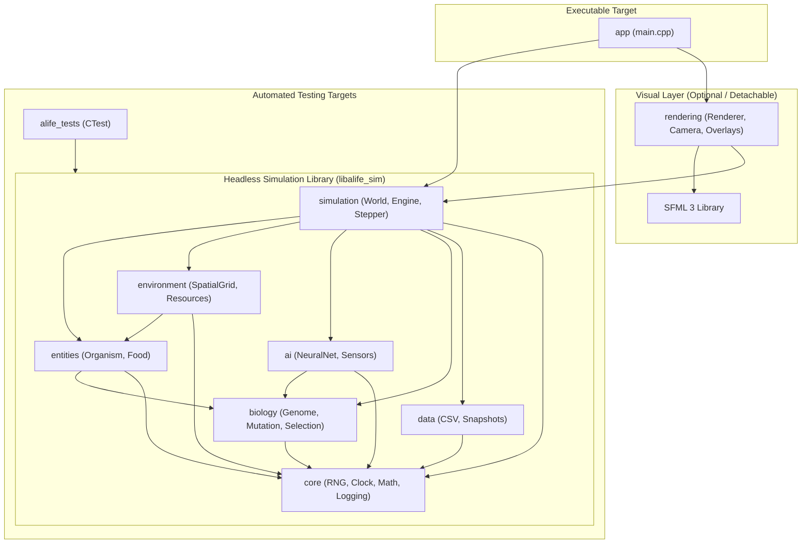

# Architecture & Design Specification: Artificial Life & Evolution Simulator

## 1. Executive Summary

This document specifies the technical architecture, modular decomposition, dependency boundaries, CMake build topology, coding standards, and testing strategy for the **Artificial Life & Evolution Simulator**.

The simulator is a long-term computational research and emergence laboratory implemented in **C++20** using **SFML 3** for visualization. The design strictly isolates simulation semantics, biological models, and numerical engines from rendering and user interface layers.

---

## 2. Long-Term Directory Structure

```text
./
├── CMakeLists.txt                  # Root build configuration
├── CMakePresets.json               # Developer and CI build presets
├── README.md                       # Project overview and quickstart guide
├── .gitignore                      # Git ignore rules for CMake and MSVC
├── docs/
│   ├── ARCHITECTURE.md             # This document: architectural guidelines & ADRs
│   ├── ROADMAP.md                  # Detailed phase progression (Phases 1 to 10)
│   └── EXPERIMENTS.md              # Experiment methodology, seeds, and presets
├── assets/                         # Fonts, icons, shaders (added when required)
├── include/alife/                  # Public library interface headers
│   ├── core/                       # Foundation: types, clock, RNG, logging
│   ├── biology/                    # Traits, genes, mutation, reproduction
│   ├── entities/                   # Organisms, resources, identifiers
│   ├── environment/                # Spatial grid, boundary conditions, food
│   ├── ai/                         # Sensors, neural network controllers
│   ├── simulation/                 # Simulation engine, world state, coordinator
│   ├── data/                       # Serialization, CSV export, telemetry
│   └── rendering/                  # SFML rendering, camera, visual overlays
├── src/
│   ├── main.cpp                    # Application entry point
│   ├── core/                       # Core implementations
│   ├── biology/                    # Biology implementations
│   ├── entities/                   # Entity implementations
│   ├── environment/                # Environment implementations
│   ├── ai/                         # Neural network implementations
│   ├── simulation/                 # World state and stepper implementations
│   ├── data/                       # CSV export and snapshot implementations
│   └── rendering/                  # SFML 3 renderer & view implementations
└── tests/
    ├── CMakeLists.txt              # Test suite configuration
    ├── unit/                       # Deterministic logic tests (headless)
    │   ├── test_core.cpp           # RNG, clock, math tests
    │   └── test_simulation.cpp     # Simulation rules without graphics
    └── integration/                # Multi-system regression tests
```

### Module Responsibilities & Boundary Invariants

| Module | Primary Responsibility | What Belongs Inside | What MUST NOT Belong Inside | Allowed Dependencies |
| :--- | :--- | :--- | :--- | :--- |
| **`core`** | Platform primitives & numeric foundations | Vector types, fixed/variable clock, deterministic PRNG (`std::mt19937_64`), logging utilities | Any simulation state, organisms, or SFML code | Standard Library (`<random>`, `<chrono>`, `<concepts>`) |
| **`biology`** | Evolutionary genetics & traits | Genome representations, mutation operators, crossover, trait decoding, fitness metrics | SFML drawing code, windowing, UI | `core` |
| **`entities`** | Domain objects | Organism entity, Food entity, unique IDs (`EntityId`), energy counters | Direct SFML drawing, window handles | `core`, `biology` |
| **`environment`** | World layout & spatial queries | Spatial hash grid, bounds checking, resource distribution, terrain flags | UI controls, SFML drawing logic | `core`, `entities` |
| **`ai`** | Decision controllers | Sensory input vectors, neural net layers, activation functions, controller interface | Direct world manipulation, SFML calls | `core`, `biology` |
| **`simulation`** | State coordinator & stepping | `World`, `SimulationEngine`, fixed-step update loop, step events | Window management, direct rendering | `core`, `biology`, `entities`, `environment`, `ai` |
| **`data`** | Telemetry & persistence | CSV exporters, metrics aggregation, state snapshot serialization | SFML rendering, game loops | `core`, `simulation`, `entities` |
| **`rendering`** | Visual presentation | SFML 3 `RenderWindow`, sprite/shape batching, camera view, grid renderer | Biological rules, physics stepping | `core`, `simulation`, `entities`, `environment`, **SFML 3** |
| **`app` (`main.cpp`)** | Composition root | Startup, CLI parsing, wiring `SimulationEngine` with `Renderer`, main loop | Direct implementation of biological rules | `simulation`, `rendering`, `data` |

---

## 3. Dependency Architecture & Layering

Strict acyclic layer hierarchy ensures headless simulation runs for testing, profiling, and benchmarking:



### Invariant Rules
1. **Headless Invariant:** No file in `core`, `biology`, `entities`, `environment`, `ai`, `simulation`, or `data` may include `<SFML/...>`.
2. **Determinism Invariant:** Simulation logic never queries system clock directly; time steps and random sequences are passed explicitly through `core::Clock` and `core::Rng`.
3. **No Circular Dependencies:** A module may only include modules lower in the hierarchy.

---

## 4. CMake Target Architecture

To minimize compilation times while providing clear boundaries:

1. **`alife_sim` (Static Library):**
   - Contains all headless simulation code (`core`, `biology`, `entities`, `environment`, `ai`, `simulation`, `data`).
   - Requires C++20 (`cxx_std_20`).
   - Completely free of SFML dependencies.
   - Linked by both the main application and the automated test suites.

2. **`alife_app` (Executable Target):**
   - Links `alife_sim` and `rendering`.
   - Links SFML 3 components (`SFML::Graphics`, `SFML::Window`, `SFML::System`).
   - Contains the presentation loop and interactive controls.

3. **`alife_tests` (Test Executable Target):**
   - Links `alife_sim`.
   - Runs headless via CTest in CI or local terminals.

---

## 5. Coding Conventions

- **C++ Standard:** C++20 standard library features preferred (`std::span`, `std::unique_ptr`, `std::optional`, `<concepts>`, `<ranges>`).
- **Naming Conventions:**
  - Namespaces: `alife::core`, `alife::sim`, `alife::bio`, `alife::render`.
  - Types / Classes / Structs: `PascalCase` (e.g. `Organism`, `SimulationEngine`).
  - Functions & Methods: `camelCase` (e.g. `updateEnergy()`, `advanceStep()`).
  - Variables & Member Variables: `camelCase` with trailing underscore for private members (e.g. `stepCount_`, `energy_`).
  - Constants & Enums: `PascalCase` or scoped enums `enum class State { Running, Paused };`.
- **Memory & Resource Management:**
  - RAII on all resource allocations.
  - Value semantics and move semantics by default.
  - Pointers only for non-owning observation (`const T*` or `std::span<T>`).
  - No raw `new`/`delete`.
- **Error Handling:**
  - Invariants and preconditions verified with assertions (`assert` or custom debug macro).
  - Recoverable configuration/IO errors handled via `std::expected` or exception hierarchies.

---

## 6. Architecture Decision Records (ADR)

### ADR-01: Headless Simulation Engine Separation
- **Decision:** Split simulation logic completely from rendering into a dedicated static library `alife_sim`.
- **Rationale:** Enables running experiments 100x faster than real-time without GPU overhead, allows headless CI test automation, and keeps logic testable without window context.

### ADR-02: Fixed-Timestep Stepping
- **Decision:** The simulation ticks at a deterministic fixed time increment $\Delta t$ (e.g. 1/60s), decoupled from the rendering framerate.
- **Rationale:** Ensures repeatability and reproducibility regardless of display refresh rate or hardware performance.

### ADR-03: Seeded PRNG Dependency Injection
- **Decision:** Centralize random number generation in `core::Rng` wrapping `std::mt19937_64`, passed by reference to any subsystem needing randomness.
- **Rationale:** Guarantees that any experiment can be accurately reproduced by recording the initial seed and configuration parameters.

### ADR-04: SFML 3 Integration Strategy via CMake FetchContent / vcpkg
- **Decision:** Use standard CMake `FetchContent` or package config for SFML 3, isolated solely inside the `rendering` and `alife_app` targets.
- **Rationale:** Leaves the core algorithm and data structure library portable across environments with zero graphical prerequisites.
